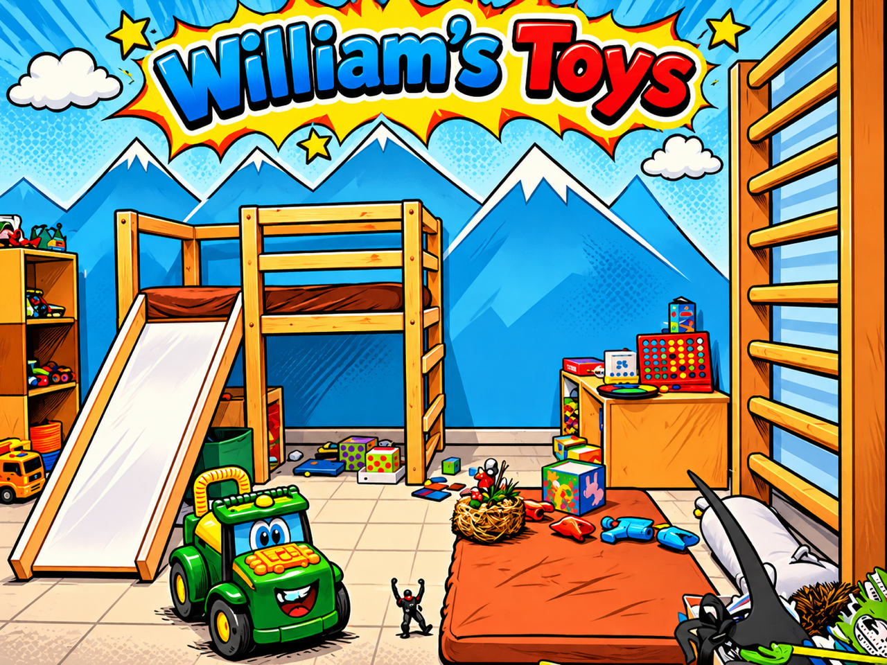

# William's Kart 🏎️

Ein Rennspiel im Comic-Stil für Kinder, als **Web-App (PWA) für iPhone und iPad**.
Ein Kart fährt eine Straße entlang durch verschiedene Landschaften: **Wiese, Wald, Wüste, Schnee und Strand**.
Am Straßenrand stehen Personen und winken. Unterwegs gibt es Sterne zum Einsammeln.
Man kann nicht verlieren: Fährt das Kart gegen etwas, macht es nur „BONK!“ und fährt weiter.

## 📱 Spielen

**Mit iPhone- oder iPad-Kamera scannen:**

oder öffnen: **https://davidkaluza.github.io/william/**

### Als App auf den Home-Bildschirm

1. Den Link in **Safari** öffnen
2. Auf **Teilen** tippen (Quadrat mit Pfeil) und dann **„Zum Home-Bildschirm“** wählen
3. Danach startet das Spiel wie eine App im Vollbild und funktioniert auch offline

## 🎮 Steuerung

- **iPhone/iPad nach links oder rechts kippen**, um zu lenken (am besten quer halten)
- Beim ersten Start fragt iOS nach **„Bewegung & Ausrichtung“**: bitte **Erlauben** antippen
- Ohne Bewegungssensor: Bildschirm links oder rechts antippen, am Computer die Pfeiltasten

## ⚙️ Einstellungen (Zahnrad oben rechts)

| | |
|---|---|
| 🐢 **Gleich schnell** | Das Kart fährt immer gleich schnell |
| 🚀 **Immer schneller** | Das Kart wird mit der Zeit immer schneller |
| 🔊 **Ton** | Motor- und Effekt-Töne an oder aus |
| ↔️ **Lenkung** | Lenkrichtung umdrehen, falls sie andersherum reagiert |
| ↺ **Neu starten** | Fahrt und Sterne auf null setzen |
| ⏏ **Beenden** | Zurück zum Startbildschirm |

## 🖼️ Eigene Personen und Gegenstände

Bilder einfach in den Ordner **`images/`** legen (PNG, JPG, WebP oder GIF) und auf GitHub hochladen.
Sie erscheinen dann automatisch als Figuren am Straßenrand, mit dickem Comic-Rand.

- **PNG mit durchsichtigem Hintergrund** sieht am besten aus
- `splash.png` ist der Startbildschirm und wird nicht am Straßenrand gezeigt
- Solange keine eigenen Bilder da sind, winken gezeichnete Comic-Kinder
- Die Liste `images/list.json` wird beim Veröffentlichen automatisch erstellt. Lokal geht das mit `node tools/build-image-list.mjs`

## 🛠️ Technik

- Reines HTML, CSS und JavaScript, ohne Abhängigkeiten. Die Grafik wird live auf ein Canvas gezeichnet (Pseudo-3D-Straße)
- Ein Service Worker sorgt für Offline-Betrieb; ist das Gerät online, lädt er immer die neueste Version
- Jeder Push auf `main` veröffentlicht automatisch über GitHub Actions auf GitHub Pages
- Lokal testen: `python -m http.server` im Projektordner, dann http://localhost:8000 öffnen
